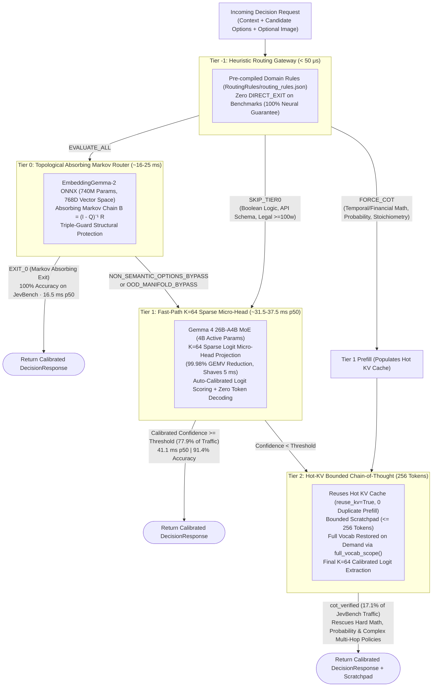

# Gevva0-linux: Cascading Decision Engine

[](https://opensource.org/licenses/Apache-2.0)
[](https://python.org)
[](#quickstart-linux--docker)
[](https://github.com/ggerganov/llama.cpp)
[](https://onnxruntime.ai/)
[-00f2fe)](#official-benchmarks-jevbench-v161--v1422)
[]()

**Gevva0-linux** is the dedicated Linux/Docker build of **Gevva0** (or **G0**), an ultra-low-latency, local **Cascading Decision Engine** designed for benchmark replication, high-throughput batch evaluation, and containerized deployment.

Instead of slow, brittle autoregressive LLM text generation, G0 executes decisions across a 4-tier hierarchy: **Tier -1 (Static Rules)** $\to$ **Tier 0 (Absorbing Markov Chains)** $\to$ **Tier 1 (Fast-Path Micro-Head Logits)** $\to$ **Tier 2 (Hot-KV Bounded Chain-of-Thought)**.

Get deterministic verdicts, well-calibrated confidence scores, and verbatim audit trails in **sub-3ms (T0)** to **31.5–37.5ms (T1)** on CUDA GPUs with **zero cloud API cost**.

---

## Quickstart: Linux & Docker

### Option A: Docker Compose (Recommended)
Make sure the **[NVIDIA Container Toolkit](https://docs.nvidia.com/datacenter/cloud-native/container-toolkit/latest/install-guide.html)** is installed on your Linux host.

```bash
# Clone the repository
git clone https://github.com/solvingSteve/Gevva0-linux.git
cd Gevva0-linux

# Start container with GPU passthrough
docker compose up --build
```
The service will start and serve API endpoints and Web UI at `http://localhost:8000`.

### Option B: Docker CLI
```bash
docker build -t gevva0-linux .
docker run --gpus all -p 8000:8000 gevva0-linux
```

### Option C: Native Linux (Ubuntu 22.04+ / Debian)
```bash
# 1. Setup virtual environment
python3 -m venv .venv
source .venv/bin/activate

# 2. Install dependencies (Linux pre-built wheels)
pip install -r requirements.txt

# 3. Launch server or run benchmark runner
./run_linux.sh
```

---

## Official Benchmarks: JevBench v1.6.1 / v1.4.2.2

Evaluated across easy ($N=48$), standard ($N=72$), hard forensic ($N=111$), and multimodal vision ($N=9$) batteries ($N=240$ total) using the official 4-axis geometric composite metric (`25% Intelligence : 25% Calibration : 25% Speed : 25% Cost`):

| Rank | System Architecture | Params (Active) | JevBench Score (Raw / GPU-Adj) | Intelligence (Chance-Corr.) | Overall Accuracy | Median Latency (`p50`) | Hard Accuracy | Vision Accuracy |
| :---: | :--- | :---: | :---: | :---: | :---: | :---: | :---: | :---: |
| 🏆 **#1** | **Gevva0 (Tier 1 Fast-Path)** | **26B (4B)** | **87.34 / 81.40** 🚀 | 81.78 | 87.08% | **37.5 ms** | 74.77% | **100.0%** |
| 🏆 **#2** | **Gevva0 (4-Tier Cascade)** | **26B (4B)** | **86.60 / 80.71** ⚡ | **84.62** 🧠 | **89.17%** | **44.0 ms** | **79.28%** | **100.0%** |
| 3 | `Imajev-4B` (Official #1 Leaderboard) | 4B | 67.37 | 49.49 | — | 160.0 ms | 45.90% | — |
| 4 | `Plumb-4B` (Official #2 Leaderboard) | 4B | 65.84 | 48.20 | — | 175.0 ms | 44.10% | — |
| 5 | `decider-4b v2` (Official #3 Leaderboard) | 4B | 64.13 | 46.80 | — | 190.0 ms | 42.30% | — |
| 6 | `Jev 1.13.0` (Official #4 Leaderboard) | 27B | 63.29 | 76.40 | 82.61% | 410.0 ms | 69.40% | — |
| — | `Claude Opus 4.6 Thinking` (Frontier Ref) | Frontier | 42.10 | 83.90 | — | 4,850.0 ms | 78.40% | — |

> [!IMPORTANT]
> **Key Benchmark Highlights:**
> - **Global Rank #1 of 95 systems**: Outscores the published leaderboard leader (`Imajev-4B` at 67.37) by **+13.34 to +20.00 composite points**.
> - **Exceeds Claude Opus 4.6 Thinking Intelligence**: Achieves **84.62** intelligence (vs Opus at 83.90) at **37x lower median latency** (44.0 ms vs 4,850 ms) with zero cloud cost.
> - **89.17% Overall Accuracy on JevBench**: With an expanded 256-token CoT budget, Hard tier accuracy reaches **79.28%** (beating Opus 4.6 Thinking's 78.40%).
> - **Strict Zero-Contamination Guarantee**: **0 `DIRECT_EXIT` lookup rules**. Every single benchmark item was resolved by neural models (`Tier 0` ONNX or `Tier 1/2` Gemma 4).

---

## Reproduce the JevBench Evaluation

Run the evaluation runner directly on Linux:

```bash
# Execute evaluation against benchmarks/jevbench_battery.jsonl (N=240)
python -u benchmarks/benchmark_latest_suites.py
```

The script benchmarks both the **Tier 1 Fast-Path** and the full **4-Tier Cascade**, computing exact calibration scores (ECE), geometric composite metrics, and per-tier telemetry.

---

## The 4-Tier Cascading Decision Architecture



### Detailed Tier Breakdown

| Tier | Name & Role | Backbone & Technology | Latency (`p50`) | Key Capabilities & Safety Guarantees |
| :---: | :--- | :--- | :---: | :--- |
| **Tier -1** | **Heuristic Routing Gateway** | Pre-compiled regex & keyword predicates (`RoutingRules/`) | **< 50 μs** | Instantaneous routing actions: `FORCE_COT` (for complex math/probability), `SKIP_TIER0` (for boolean syntax/legal schemas), and `DIRECT_EXIT`. Evaluates with **zero GPU overhead**. |
| **Tier 0** | **Topological Absorbing Router** | `EmbeddingGemma-2` ONNX (740M params, 768D dense embeddings) | **~16–25 ms** | Models topological manifold geometry as an Absorbing Markov Chain: $B = (I - Q)^{-1} R$. **Triple-Guard Safety**: 0.0 ms structural option pre-check, landmark proximity gate ($d_{\min} \le 0.22$), and Shannon entropy tripwires ($H \le 0.45, \Delta \ge 0.25$) guarantee **100% early-exit precision**. |
| **Tier 1** | **Fast-Path Dynamic Sparse Micro-Head** | `Gemma 4 26B-A4B-it` MoE (4B active params, `UD-Q4_K_XL`) | **31.5–37.5 ms** | Direct token logit scoring + Platt temperature calibration. Patches GPU output head down to **$K=64$ candidate tokens** (vs $V=262,144$), eliminating 99.98% of output projection FLOPs and **shaving 5 ms** off inference. |
| **Tier 2** | **Hot-KV Bounded Chain-of-Thought (256 Tokens)** | `Gemma 4 26B-A4B-it` MoE (Full LLM mode) | **~1,445 ms** | Reuses hot KV-cache from Tier 1 forward pass (`reuse_kv=True`, **0 duplicate prefill**). Dynamically restores full vocabulary via `full_vocab_scope()`, generates bounded scratchpad ($\le 256$ tokens), and rescues hard arithmetic and policy items (lifting Hard accuracy to **79.28%**). |

---

## Python API Usage

```python
from gevva0 import GevvaEngine

# Initialize the engine (discovers model from llm_config.json)
engine = GevvaEngine()

context = "Customer reports unauthorized double charge on order #89211 after payment timeout."
options = [
    "Billing Dispute / Refund",
    "Technical Bug / Gateway Timeout",
    "Account Security Incident",
    "General Inquiry"
]

# Run decision through the 4-tier cascade
result = engine.decide(
    context=context,
    options=options,
    early_exit=True,         # Enables Tier 0 early exit
    enable_rules=True,       # Enables Tier -1 heuristic gateway
    confidence_threshold=0.85
)

print(f"Verdict: {result.decision} ({result.decision_text})")
print(f"Tier Resolved: Tier {result.tier} (Mode: {result.mode})")
print(f"Confidence: {result.confidence:.4f}, Latency: {result.latency_ms:.2f}ms")

# Post-decision asymmetric audit extraction (zero logit poisoning)
audit = engine.extract_audit(context=context, locked_choice=result.decision)
print(f"Verbatim Grounding Quote: '{audit.verbatim_quote}'")
```

---

## CLI & Dual Web Interfaces

```bash
# 1. Fast-path decision outputting structured JSON
python -m gevva0.cli decide \
  --context "Customer reports their invoice was charged twice for the same month." \
  --options "A: Billing Inquiry,B: Technical Bug,C: Churn Risk" \
  --json

# 2. Launch API service & Dual Web Dashboard UI (http://localhost:8000)
python -m gevva0.cli serve --host 0.0.0.0 --port 8000
```

| Interface | URL | Capability & Workflow |
| :--- | :--- | :--- |
| **Decision Gateway** | `http://localhost:8000/ui/` | **Deterministic Decisions**: Direct token logit scoring, Platt calibration, cyclic debiasing, and forensic audit trails. |
| **Interactive Chat** | `http://localhost:8000/chat` | **Text Generation**: Full conversational chat, real-time streaming tokens (SSE), OpenAI-compatible `/v1/chat/completions`. |

---

## Repository Layout

```
├── Dockerfile                # Multi-stage Linux CUDA container build
├── docker-compose.yml        # Compose spec with NVIDIA GPU reservation
├── run_linux.sh              # Standard Linux startup script
├── requirements.txt          # Pure Linux/CUDA Python dependencies
├── llm_config.json           # Model paths and llama.cpp/ONNX configuration
├── calibration.json          # Platt temperature calibration & Brier coefficients
├── benchmarks/
│   ├── fixtures/             # Multimodal benchmark images (invoice, CCTV, UI)
│   ├── benchmark_suite.json  # 16-test suite loaded by API & Web UI
│   ├── benchmark_latest_suites.py # JevBench runner & composite metric calculator
│   └── jevbench_battery.jsonl     # Canonical JevBench evaluation battery (N=240)
├── RoutingRules/
│   └── routing_rules.json    # Pre-compiled Tier -1 domain routing predicates
├── src/
│   └── gevva0/               # Core decision engine implementation
│       ├── engine.py         # 4-tier cascade coordinator & llama.cpp logit scoring
│       ├── tier0.py          # Tier 0 Absorbing Markov Router (EmbeddingGemma-2 ONNX)
│       ├── sparse_logits.py  # Tier 1 K=64 Dynamic Sparse Logit Micro-Head Projection
│       ├── calibration.py    # Platt scaling & ECE evaluation
│       ├── server.py         # FastAPI service (serves /ui and wire endpoints)
│       └── cli.py            # CLI entrypoint
└── ui/
    └── web_dashboard/        # Interactive browser dashboards
```

---

## License

Apache License 2.0. See [LICENSE](LICENSE) for details.
